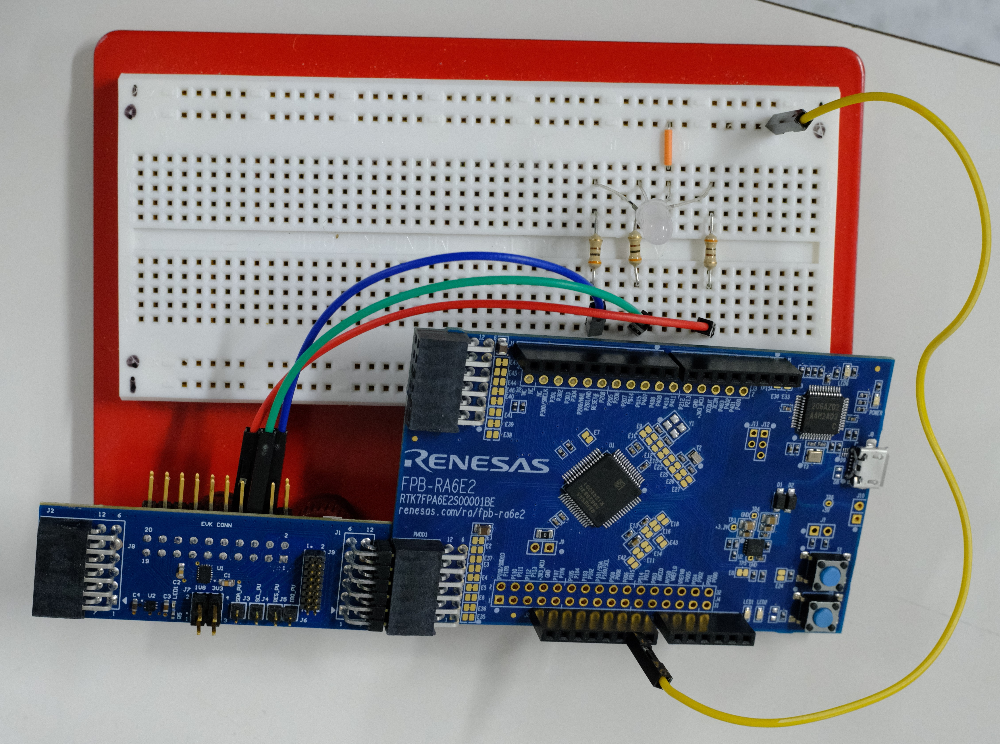
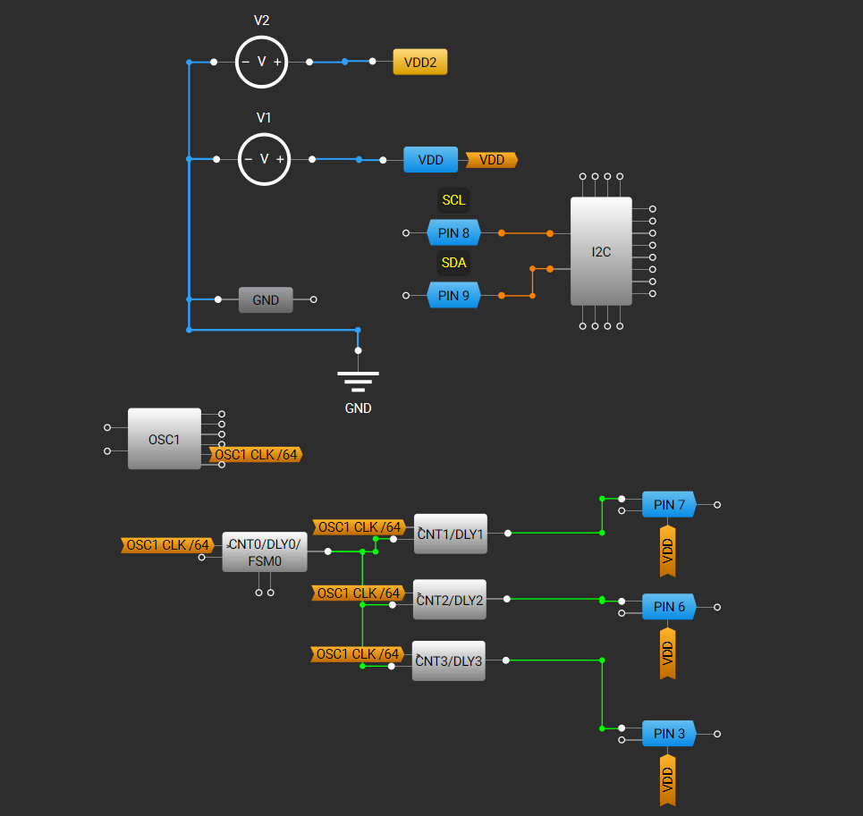

# GreenPAK I2C Communication

## Intro

GreenPAK ICs are reprogrammable and can implement custom digital and analog logic. GreenPAK devices have an I2C line so that other devices can perform reads and writes to internal memory. This functionality can be used to change the behavior of the GreenPAK device.

> **_NOTE:_**  Whenever possible, this document uses the language "Controller/Target" to refer to the two sides of an I2C transaction.

## GreenPAK I2C Communication Module (rs_gp_i2c)

A GreenPAK I2C instance (`rs_gp_i2c`) handles read and write functionality for a single `rm_comms_i2c` instance. This module is designed to work with FreeRTOS. It depends on FSP's I/O Port module and I2C Communication Device (rm_comms_i2c) module.

In an FSP project, include `rs_gp_i2c.h` in a C file to be able to use the module.

### Control and Configuration Blocks

The `rs_gp_i2c` module exposes the `gp_i2c_ctrl_t` and `gp_i2c_cfg_t` structures. These two structures when paired together can be treated as a self contained instance. The `gp_i2c_cfg_t` structure contains configuration options that control the behavior of this instance.

The `gp_i2c_cfg_t` is only used when opening the instance, while the `gp_i2c_ctrl_t` is passed to every function in the `rs_gp_i2c` module. The `gp_i2c_ctrl_t` (the control block) encodes whether the instance is open or not and contains instance-specific data that is utilized by the functions in this module. It is highly recommended not to modify the members of the `gp_i2c_ctrl_t`.

The `gp_i2c_cfg_t` structure is laid out as follows:

| Member Name | Type |  Use |
|-|-|-|
| p_comms_instance | const rm_comms_instance_t * | Pointer to Communications Middleware instance. Used for I2C transactions. |

### Methods

The following sections describe how to use the functions exposed by the GreenPAK I2C module.

Each function is structured like an FSP method, returning an FSP error/success value in the form of the `fsp_err_t` type. The parameters and possible errors that can be returned by each function is documented inside of `rs_gp_i2c.c`.

#### Opening and Closing the Underlying I2C Device and Bus

In order to use an `rm_comms_i2c` instance, the underlying hardware-specific I2C Controller implementation must be opened. The GreenPAK I2C module also relies on bus-level mutex and semaphore support; they must be instantiated before I2C transactions can occur.

The rs_gp_i2c_OpenI2CBus and rs_gp_i2c_CloseI2CBus functions perform the required setup and should be called once for each I2C bus. They both take a pointer to a `gp_i2c_cfg_t` structure and return a `fsp_err_t` value.

```c
fsp_err_t err = rs_gp_i2c_OpenI2CBus(&g_gp_i2c_cfg);
if (FSP_SUCCESS != err)
{
    return err;
}
err = rs_gp_i2c_CloseI2CBus(&g_gp_i2c_cfg);
```

The `rs_gp_i2c_OpenI2CBus` function will return an error if the bus has already been opened, or if opening the bus failed.
The `rs_gp_i2c_CloseI2CBus` function will return an error if the bus is closed, or if closing the bus failed.

#### Opening and Closing the GreenPAK I2C Instance

The following code opens and closes a GreenPAK I2C instance:

```c
fsp_err_t err = rs_gp_i2c_Open(&g_gp_i2c_ctrl, &g_gp_i2c_cfg);
if (FSP_SUCCESS != err)
{
    return err;
}

err = rs_gp_i2c_Close(&g_gp_i2c_ctrl);
```
The `rs_gp_i2c_Open` function will return an error if the instance has already been opened.
The `rs_gp_i2c_Close` function will return an error if the control structure is closed.

In order to open a `rs_gp_i2c` instance, the underlying bus must be open as well.

#### Reading and Writing to the GreenPAK Instance

The GreenPAK I2C module provides multiple helper methods for reading and writing to a GreenPAK IC over I2C.

To write some number of bytes to a word address, use the `rs_gp_i2c_WriteBytes` function.

```c
uint8_t p_bytes[3] = {0x00, 0x01, 0x10};
fsp_err_t err = rs_gp_i2c_WriteBytes(&g_gp_i2c_ctrl, WORD_ADDRESS, p_bytes, 3);
if (FSP_SUCCESS != err)
{
    return err;
}
```

To read some number of bytes from a word address, use the `rs_gp_i2c_ReadBytes` function.

```c
uint8_t p_bytes[3] = { 0 };
fsp_err_t err = rs_gp_i2c_ReadBytes(&g_gp_i2c_ctrl, WORD_ADDRESS, p_bytes, 3);
if (FSP_SUCCESS != err)
{
    return err;
}
// p_bytes[] == { 0x00, 0x01, 0x10 }
```

When reading and writing to a specified address, the GreenPAK device will keep track of an address pointer. After a transaction, this pointer will be set to the address after the one that was just accessed. By default, when reading from a GreenPAK device without specifying a word address, a read will be initiated that starts from this pointer. This can be done with the `rs_gp_i2c_CurrentAddressReadBytes` function.

```c
uint8_t p_bytes[3] = {0x00, 0x01, 0x10};
fsp_err_t err = rs_gp_i2c_WriteBytes(&g_gp_i2c_ctrl, WORD_ADDRESS, p_bytes, 3);
if (FSP_SUCCESS != err)
{
    return err;
}

// Setting the default address pointer with a read for demonstration purposes
uint8_t temp = 0;
err = rs_gp_i2c_ReadBytes(&g_gp_i2c_ctrl, WORD_ADDRESS - 1, &temp, 1);
if (FSP_SUCCESS != err)
{
    return err;
}

uint8_t p_read_bytes[3] = { 0 }
err = rs_gp_i2c_CurrentAddressReadBytes(&g_gp_i2c_ctrl, p_read_bytes, 3);
if (FSP_SUCCESS != err)
{
    return err;
}

// p_read_bytes[] == { 0x00, 0x01, 0x10 }
```

There are also three other R/W functions that operate on a single byte instead: `rs_gp_i2c_WriteByte(p_ctrl, address, p_byte)`, `rs_gp_i2c_WriteByte(p_ctrl, address, p_read_byte)`, and `rs_gp_i2c_CurrentAddressReadByte(p_ctrl, p_read_byte)`.


## Example Projects

This package contains a FreeRTOS-based example project that has been ported to the FPB-RA4E2 and FPB-RA6E2 evaluation boards. When the example project is set up correctly, pressing SW1 will send I2C messages to a GreenPAK device. A series of register writes to the SLG46826 changes the duty cycle of three PWM outputs that are connected to an RGB LED. After the register writes are completed, the example project will perform a series of register reads. The results of those reads will then be sent over the JLink Virtual COM Port.

This example project uses the GPIO Debounce, Console IO, and GreenPAK I2C modules.

The example projects come with multiple different source files:

- GreenPAK I2C Layer
  - `rs_gp_i2c.c/h`
    - Contains public functions that implement GreenPAK I2C logic. This code is designed to be used within any FSP project.
- Configuration Layer
  - `rs_gp_i2c_config_[BOARD].c/h`
    - Contains reference configurations for each example project. They are unique to each supported board.
  - `rs_gp_i2c_cfg_gen.c/h`
    - Provides an optional mechanism for populating and checking a `gp_i2c_cfg_t` at runtime. These files depend on the reference configurations but are shared between all example projects.
- Demo Layer
  - `button_thread.c`
    - This contains entrypoint code for the button thread. It polls Switch 1 on the FPB and sends a task notification to the RGB LED thread when the switch was pressed.
  - `rgb_thread.c`
    - This contains entrypoint code for the RGB LED control thread. It responds to task notifications, writes a cycled selection of RGB values to the GreenPAK I2C port, and reads those same values back to print to the J-Link Virtual COM port.

The example projects are located in the [examples](../examples) directory. There are two copies of these example projects, one targeting e2 studio and the other targeting Visual Studio Code with the Renesas VS Code Extensions. For more information about how to build FSP projects in VS Code, read the [Renesas VS Code Extensions documentation](https://tool-support.renesas.com/e2studio/vscode/docs/index.html). Resources about e2 studio can be found [here](https://www.renesas.com/en/software-tool/e2-studio) as well.

### Config Generation

When evaluating a project it may be helpful to change different parameters without having to recompile your program. Additionally, it can be helpful to use a pre-set configuration when evaluating a project and validate that it is proper during runtime.

The configuration generation functions present in the `rs_gp_i2c_cfg_gen` files perform this function.

Calling the `fsp_err_t rs_gp_i2c_GenConfig (gp_i2c_cfg_t * const p_cfg, uint32_t const config_size)` function will copy a reference configuration (stored in flash and can be found in `gp_i2c_config_*.c/h`). This function also takes in a `config_size` parameter for validation checking. This structure can then be used in the entrypoint of the example project.

The `fsp_err_t rs_gp_i2c_CheckConfig (gp_i2c_cfg_t const * const p_cfg)` function makes sure that the provided `p_cfg` matches the reference configuration.

The `fsp_err_t rs_gp_i2c_GetConfigSize (uint32_t * p_size)` function stores the size of the configuration struct into `p_size`.

### Hardware Requirements

This example project targets FSP 6.5.0 and runs on the Renesas FPB-RA4E2 and FPB-RA6E2 evaluation kits. A micro-USB cable is needed to program the MCU. A [QCIOT-SLG46826POCZ](https://www.renesas.com/en/design-resources/boards-kits/qciot-slg46826pocz) evaluation board is needed so that a Renesas RA MCU can communicate with a GreenPAK SLG46826V IC through a PMOD connector. Additionally, a development kit like the [SLG4DVKADV](https://www.renesas.com/en/design-resources/boards-kits/slg4dvkadv) is required in order to program a GreenPAK evaluation board. Additionally, three resistors and an RGB led are needed.

### Hardware Setup

A picture and diagram of the hardware setup for this example project are shown below. This setup is identical between the FPB-RA4E2 and the FPB-RA6E2.




The [QCIOT-SLG46826POCZ](https://www.renesas.com/en/design-resources/boards-kits/qciot-slg46826pocz) board is attached to an FPB-RA6E2 board via its PMOD1 connector. Pins 7, 6, and 3 on the QCIOT-SLG46826POCZ's EVK connector are connected to the red, green, and blue pins on a 4-pin RGB LED bulb. A resistor is placed between each connection to avoid damaging the LED. The RGB LED is common-cathode, so the 2nd pin on the LED should be connected to ground. In the attached image, the ground terminal of the LED is connected by a yellow wire to port J2-7 on the FPB-RA6E2.

The SLG46826V IC is programmed with the GreenPAK configuration shown below:



This configuration is based off the one included with the ["Using GreenPAK’s I2C Port to Control an RGB LED’s Color on SLG46537" application note.](https://www.renesas.com/ja/document/apn/1098-using-greenpaks-i2c-port-control-rgb-leds-color). Pins 8 and 9 are connected to an I2C block. An oscillator is connected to multiple counters. In this project, CNT0 is configured to overflow around every 8 milliseconds. The output of CNT0 is then connected to three other counters (CNT1, CNT2, CNT3) that are set to one-shot mode. When these counters detect a rising signal from CNT0, they generate a pulse that lasts a configurable number of cycles from 0 to 255. This GreenPAK configuration is downloadable from this repo in the [examples](../examples) directory. For more information on how to flash a GreenPAK device, read the [GreenPAK Advanced Development Platform User Manual.](https://www.renesas.com/en/document/mat/greenpak-advanced-development-platform-user-guide)


### Module Configuration

The reference configuration for the GreenPAK I2C instance is quite short, pointing to a `rm_comms_i2c` instance:

```c
gp_i2c_cfg_t g_gp_cfg = {
    .p_comms_instance = &g_comms_i2c_device0_ref
};
```

Each COMMS instance include a pointer to a shared I2C bus configuration. This shared bus configuration is used by the COMMS I2C module to synchronize one or more COMMS instances with a single I2C controller implementation. On the FPB-RA4E2 and FPB-RA6E2, the I2C bus should be configured to use an instance of the I2C/I3C Controller (`r_iic_b_master`) module. The COMMS I2C module will automatically configure the I2C controller based on which COMMS instance is currently using the bus.

#### I2C Stack Configuration

The underlying COMMS instance is configured as follows:

- **Name:** g_comms_i2c_device0_ref
- **Semaphore Timeout:** 0x1000
- **Address Mode**: 7-bit
- **Target (Slave) Address**: 0x08
- **Callback**: comms_i2c_callback

The target address for every GreenPAK I2C transaction is composed of a customizable 4-bit control code and a 3-bit block address specifier. The 4-bit control code can be set in a GreenPAK project and is useful for when there are multiple GreenPAK devices on the same I2C bus. The 3-bit block address is used to change which 256-byte block of memory should be written to during a transaction. To find out more about GreenPAK block addressing, consult your device's datasheet.

When configuring an `rm_comms_i2c`, it is necessary to set the target address appropriately. For example, if you want to write to a GreenPAK device with control code 0001 at block 000, you must set the "Slave Address" in the `rm_comms_i2c` instance to `0x08`. To write to multiple blocks on a single GreenPAK device, the user must set up one `rm_comms_i2c` instance per target address that each share the same bus-level configuration.

In each `rm_comms_i2c` instance, the "Semaphore Timeout" should be set to a positive number corresponding to an amount of RTOS ticks to ensure that a failed I2C transaction does not block forever. 

The I2C Shared Bus is configured as follows:

- **Name:** g_comms_i2c_bus0_ref
- **Bus Timeout:** 0x1000
- **Semaphore for Blocking** Use
- **Recursive Mutex for Bus** Use
- **Channel**: 0
- **Rate**: Standard

In the shared bus configuration, the "Bus Timeout" should also be set to a positive number corresponding to an amount of RTOS ticks. The "Semaphore for Blocking" and the "Recursive Mutex for Bus" should also be set to "Use", and those features should be enabled in the FreeRTOS stack.

The I2C Controller configuration should be left as-is. The COMMS I2C driver will automatically set the target address and other parameters for the I2C controller.

By default, the FPB-RA4E2 and FPB-RA6E2 are configured to allow for I2C communication over the PMOD1 connector. P100 and P101 are assigned to the SDA and SCL lines of the I3C/I2C Controller Peripheral. The default jumper configuration on both boards connects these pins to PMOD1. On both boards, P100 and P101 are connected to P400 and P401 through a set of pull-up resistors. P400 controls whether P100 is being pulled up, and P401 controls whether P101 is being pulled up. Both of these pins are set to *Output Mode (Initial High)* by default so that I2C transactions can succeed.

In order to use the I3C/I2C peripheral on RA MCUs, the I3CCLK should be enabled. To enable I3CCLK, go to the "Clocks" tab of the FSP Configurator and set the *I3CCLK Src* option to "PLL".

#### GPIO Debounce Configuration

The example project's GPIO Debounce configuration looks like this:

```c
gpio_debounce_cfg_t g_gpio_debounce_cfg =
{
    .active_level      = BSP_IO_LEVEL_LOW,
    .count_to_active   = 5,
    .count_to_inactive = 5,
    .event_enable_mask = GPIO_DEBOUNCE_EVENT_PRESSED,
    .p_ioport          = &g_ioport,
    .portpin           = BSP_IO_PORT_03_PIN_04,
    .p_callback        = &button_cb,
    .p_context         = NULL
};
```

On the FPB-RA4E2 and FPB-RA6E2, P304 is connected to SW1. By default, the pin configuration for the FPB-RA4E2 and FPB-RA6E2 sets the pin to IRQ mode. In order to use P304 with the GPIO debouncing module, IRQ9 must be disabled, the pin mode must be set to *Input mode*, and the "Pull up/down" option must be set to *Input pull-up*.

For more information, read the documentation in the [GPIO Debounce repository.](https://github.com/renesas/gpio-debounce)

#### UART VCOM Configuration

In order to use the Console I/O module, there needs to be a r_sci_uart stack with the name "g_uart_jlob_vcom". This structure will automatically be configured properly, and functions from `<stdio.h>` will then route their standard output to this UART port. P410 and P411 are the default SCI UART pins, and they are both connected to the on-board J-Link debugger. The output of these ports can be viewed in any serial terminal software through a "J-Link Virtual COM Port". 

The Console I/O module depends on the `r_byteq` module, requiring the heap size of this example project to be set to a value greater than 1024 bytes. To set the heap size in a project, go to the BSP tab in the FSP configurator, go to the *RA Common* section of the Properties view, and change the value of the *Heap size (bytes)* property to 0x400.

For more information, read the documentation in the [Buffered I/O over UART repository.](https://github.com/renesas/stdio)

### Entry Point Code

This project uses a real-time operating system called FreeRTOS that is designed for resource-constrained devices, allowing for multiple tasks to run independently of each other. FreeRTOS' scheduler switches between tasks to create the appearance that all the tasks are running at the same time.

When this project starts, two tasks will be created: one for the button debouncing, and one for the LED control.

The button debounce code present in `button_thread_entry.c` looks like this:

```c
void button_thread_entry(void *pvParameters)
{
    FSP_PARAMETER_NOT_USED (pvParameters);

    rs_gpio_debounce_Open(&g_gpio_debounce_ctrl, &g_gpio_debounce_cfg);

    TickType_t xLastWakeTime = xTaskGetTickCount();

    while (1)
    {
        vTaskDelayUntil(&xLastWakeTime, (5 / portTICK_PERIOD_MS));
        rs_gpio_debounce_Update(&g_gpio_debounce_ctrl);
    }

}
```

This code will call `rs_gpio_debounce_Update` every 5 milliseconds. The GPIO debounce instance is defined in the code file. The instance has been configured so that when SW1 is pressed, this code will be called, giving a task notification to the LED control thread:

```c
extern TaskHandle_t rgb_thread;

void button_cb (const gpio_debounce_callback_args_t * p_args) {
    if (p_args->event == GPIO_DEBOUNCE_EVENT_PRESSED)
    {
        xTaskNotifyGive(rgb_thread);
    };
}
```


Before the button is pressed, the LED control thread will run the following code present in `rgb_thread.c`:

```c
void rgb_thread_entry (void * pvParameters)
{
    FSP_PARAMETER_NOT_USED(pvParameters);

#if GP_I2C_PRESET_CONFIG_USE
    rs_gp_i2c_GenConfig(p_gp_cfg, sizeof(gp_i2c_cfg_t));
#else
    gp_cfg.p_comms_instance = &g_comms_i2c_device0;
#endif

    fsp_err_t err = SLG46826_SetRGB(0, 0, 0);
    if (FSP_SUCCESS != err)
    {
        __BKPT(0);
    }
    ...
```

If it is enabled, the GreenPAK I2C configuration struct defined in this file will be populated through the `rs_gp_i2c_GenConfig(r, g, b)` function. Otherwise, it will be set to the stack configuration structure from the FSP generator.RGB LED will be turned off through the wrapper function `SLG46826_SetRGB`. This function is defined in the `rgb_thread.c` file and will try to open the GreenPAK I2C instance and its underlying I2C bus (using the `rs_gp_i2c_OpenI2CBus` and `rs_gp_i2c_Open` functions). It will then write the values provided in the function to the registers `0xAA`,  `0xAF`, and `0xB3`. These registers correspond to the counter values for CNT1 (R), CNT2 (G), and CNT3 (B).

After this point, this is what the code looks like:

```c
    ...
    
    uint8_t current = 0;
    size_t num_colors = (sizeof(rainbow) / sizeof(uint8_t)) / 3;

    while (1) {
            ulTaskNotifyTake( pdTRUE, portMAX_DELAY );

            uint8_t r = rainbow[current * 3];
            uint8_t g = rainbow[(current * 3) + 1];
            uint8_t b = rainbow[(current * 3) + 2];

            err = SLG46826_SetRGB(r, g, b);
            if (FSP_SUCCESS != err)
            {
                __BKPT(0);
            }

            printf("The LED color has been changed. ");

            rs_gp_i2c_ReadByte(p_gp_ctrl, RED_ADDRESS, &r);
            rs_gp_i2c_ReadByte(p_gp_ctrl, GREEN_ADDRESS, &g);
            rs_gp_i2c_ReadByte(p_gp_ctrl, BLUE_ADDRESS, &b);

            printf("New Value: %02x %02x %02x\r\n", r, g, b);

            current = (current + 1) % (num_colors);
    }
}
```

The `ulTaskNotifyTake` function is called to block until a task notification is received. After this, RGB values will be cycled through six preset values defined in an array called `rainbow`. The `current` variable cycles around every time the value exceeds the number of RGB values present in the array. The accessed RGB values will be used to set the color of the RGB LED. The registers will be read back from afterwards and logged to the serial terminal.

### Running the Project

When running this project, make sure that the GreenPAK device is flashed with the included configuration. Afterwards, connect everything as shown in the image attached to the *Hardware Configuration* section. Once that is done, flash the FPB with the example project.

If the project works properly, pressing SW1 should change the color of the connected RGB LED.

To view the serial console output in Tera Term, select the *J-Link Virtual COM Port*. Then, on the top bar, select Setup -> Serial Port. Change the speed to `115200`.

After this setup, pressing the button should show a message like `The LED color has been changed. New Value: 00 FF 00`.
